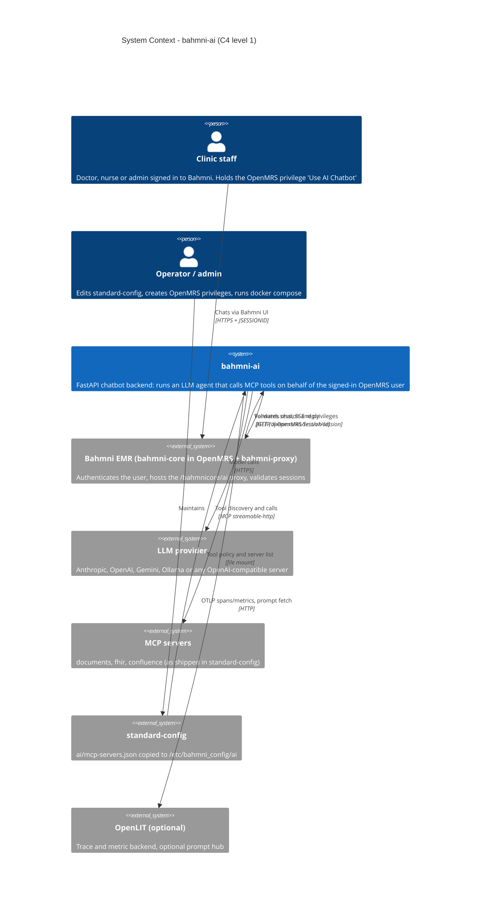
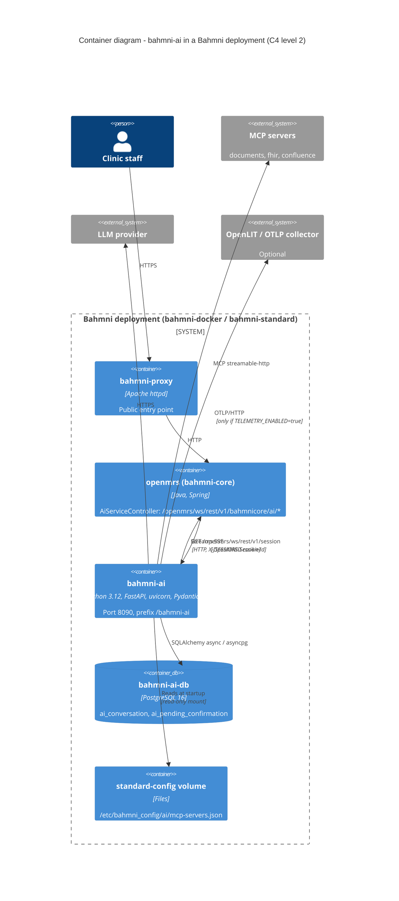

# 01 - Overview

Derived from: `pyproject.toml`, `uv.lock`, `.python-version`, `Dockerfile`, `src/bahmni_ai/main.py`, `server.py`, `settings.py`, `docker-compose.dev.yml`, `.env.example`, `../bahmni-docker/bahmni-standard/docker-compose.yml`, `bahmni-core/.../AiServiceController.java`.

## 1. What it is (plain language)

A clinic user types a question in the Bahmni UI. The request goes through Bahmni's normal login (OpenMRS). OpenMRS passes it to bahmni-ai along with the user's session id. bahmni-ai asks OpenMRS "who is this and what may they do?", then lets an AI model answer. The model may use *tools* (search documents, read FHIR data, ...) that live on separate **MCP servers**. A tool runs only if the config allows it, the user holds the required OpenMRS privilege, and (for writes and unproven tools) the user clicks confirm. The reply streams back word by word.

## 2. Repo inventory

| Item | Value | Evidence |
|---|---|---|
| Language / runtime | Python, `requires-python >=3.11`, dev/CI/Docker use 3.12 | `pyproject.toml`, `.python-version`, `Dockerfile` |
| Package | `bahmni-ai` 0.1.0, build backend hatchling, wheel `src/bahmni_ai` | `pyproject.toml` |
| Size | ~3,900 lines in `src/`, ~3,300 in `tests/` | `wc -l` |
| Web | FastAPI 0.143, uvicorn, `sse-starlette` | `uv.lock` |
| Agent framework | `pydantic-ai-slim[openai,anthropic,mcp]` 2.55 | `uv.lock` |
| MCP client | via Pydantic AI `MCPToolset`; `fastmcp-slim[client]` 4.1 comes in transitively; `mcp` 2.3 | `uv.lock`, `mcp/registry.py` |
| Persistence | SQLAlchemy 2.1 async + `asyncpg`; SQLite (`aiosqlite`) in tests | `db/postgres.py`, dev deps |
| Config | `pydantic-settings` (env vars, `.env`) | `settings.py` |
| Logging | `structlog` JSON to stdout with redaction | `logging.py` |
| Validation | `jsonschema` for tool arguments, `pydantic` for config | `mcp/policy.py`, `mcp/config.py` |
| Optional extras | `gemini` (Google SDK), `telemetry` (OpenTelemetry SDK, OTLP/HTTP, FastAPI instrumentation) | `pyproject.toml` |
| Quality tools | ruff (E,F,I,B,UP,S), mypy strict + pydantic plugin, pytest-asyncio, pytest-cov, respx | `pyproject.toml` |
| Package manager | uv (lockfile `uv.lock`) | `Dockerfile`, workflows |
| Entry points | `python -m bahmni_ai.server` (`server.main`), ASGI factory `bahmni_ai.main.create_app`, CLI `python -m bahmni_ai.providers.smoke`. **No** `[project.scripts]`. | `server.py`, `main.py`, `providers/smoke.py` |
| Plugin groups (read, none declared here) | `bahmni_ai.providers`, `bahmni_ai.prompt_sources` | `providers/registry.py`, `prompts/registry.py` |
| License | MPL-2.0 | `pyproject.toml`, `LICENSE` |

Top-level layout: `src/bahmni_ai/{agent,api,audit,auth,db,mcp,observability,prompts,providers}` plus `main.py`, `server.py`, `settings.py`, `logging.py`, `urlsafety.py`; `tests/`; `docs/`; `deploy/openlit/` (separate telemetry stack); `dev-config/mcp-servers.json` (empty server list); `.github/`.

`spike/` and `.idea/` are deleted in the working tree (git shows them as `D`); `docs/STAGE0_SPIKE_RESULT.md` and `docs/OBSERVABILITY_PHASE0_RESULT.md` keep the results.

## 3. System context (C4 level 1)

Who talks to whom: staff use Bahmni; Bahmni (bahmni-core) is the only caller of bahmni-ai. bahmni-ai depends on OpenMRS (identity and privileges), an LLM provider, and the MCP servers named in standard-config. OpenLIT is optional (traces/metrics and an optional prompt hub).

## 4. Containers (C4 level 2)

| Container | Technology | Responsibility | Evidence |
|---|---|---|---|
| bahmni-ai | FastAPI, uvicorn, port 8090, URL prefix `/bahmni-ai` | Auth, agent run, tool policy, SSE streaming, history | `main.py`, `Dockerfile` |
| bahmni-ai-db | PostgreSQL 16 | Conversation history, pending confirmations. Its own database, not OpenMRS's | `docker-compose.dev.yml`, bahmni-docker compose |
| openmrs / bahmni-core | Java | Authenticates users, gate check `Use AI Chatbot`, proxies `/bahmnicore/ai/*` to bahmni-ai | `AiServiceController.java` (outside the two repos) |
| standard-config | files in an image/volume | `ai/mcp-servers.json` | `standard-config/package/docker/Dockerfile` |
| MCP servers | external | Provide tools | `ai/mcp-servers.json` |

## 5. Runtime behaviour

- **One process**, one uvicorn worker (`uvicorn.run(create_app(settings), host, port)` in `server.py`, no `workers=` argument). Concurrency is asyncio. There is no queue, broker or cache service.
- **In-process state**: the OpenMRS session cache (30 s, max 1024 entries), the provider and prompt-source adapter registries, stdio MCP subprocesses (only if `MCP_ALLOW_STDIO=true`), the prompt refresh task, and the in-memory stores when `DATABASE_URL` is empty.
- **Startup is fail-closed** for MCP config, credentials, the prompt hub (when enabled) and the model definition. Telemetry problems only disable telemetry (see [flow 07d](04-api-and-flows.md#7d-startup-and-config-loading)).
- **Per chat turn** the service opens a fresh connection to every configured MCP server (no pooling; `McpRegistry.open`), so a user's session or token is never reused for another user. A server that fails to connect is skipped and reported (`servers_unavailable`).
- **Streaming**: the agent runs in its own `asyncio` task (`_produce`) and hands events to the HTTP generator through an `asyncio.Queue`. Cancelling the HTTP request cancels the task.

## 6. Cross-cutting concerns

| Concern | How it works | Files |
|---|---|---|
| Authentication | Only the `X-OpenMRS-Session-Id` header is trusted, and only after `GET /openmrs/ws/rest/v1/session` confirms it. Other headers (e.g. `X-User-Id`) are ignored. | `api/deps.py`, `auth/session.py` |
| Authorisation | (1) gate privilege `Use AI Chatbot` (`GATE_PRIVILEGE`) per request; (2) per-tool privilege on every tool call; (3) fresh (uncached) re-check before a write; role `System Developer` is treated as super user. | `api/deps.py`, `mcp/policy.py`, `auth/privileges.py`, `auth/context.py` |
| Confirmation | Writes (and allowed-but-unproven tools) raise `ApprovalRequired`; a single-use, user-bound, 300 s confirmation is stored and resolved through `/chat/confirm`. | `mcp/policy.py`, `agent/service.py`, `db/*` |
| Audit | One structured `tool_audit` log line per decision/outcome: who, server, tool, decision, outcome, latency, argument **names** and a 16-hex hash, never values. | `audit/log.py`, `mcp/policy.py` |
| Logging | structlog JSON; keys matching authorization/cookie/token/secret/password/api-key/session-id are masked; Bearer/Basic/JSESSIONID patterns scrubbed; `trace_id`/`span_id` added when telemetry is on. | `logging.py` |
| Error handling | Internal errors never reach the client: exceptions map to coded `error` SSE events with fixed messages. | `agent/service.py` |
| Retries | Only provider calls before streaming starts (`RetryingModel`); tool calls are never retried. | `providers/retry.py`, `mcp/registry.py` |
| Scheduling / async | No scheduler. One background task: prompt-hub refresh. | `prompts/resolver.py` |
| Feature flags | Environment settings: `PROMPT_HUB_ENABLED`, `TELEMETRY_ENABLED`, `UI_ACTIVITY_EVENTS`, `MCP_ALLOW_STDIO`, `AI_INJECT_DATETIME`, `HISTORY_TOOL_RESULTS`, per-server `propagateTrace`, `trustToolAnnotations`. | `settings.py`, `mcp/config.py` |
| Data protection | Tool output is not stored by default (`HISTORY_TOOL_RESULTS=none`); telemetry is an allowlist with content off by default. Tool results go to the chosen LLM provider (documented in OPERATIONS.md). | `agent/history.py`, `observability/scrub.py` |
| Outbound URL safety | Credentials or the user's session are only sent over https, or http to localhost, `host.docker.internal`, or a single-label container name. | `urlsafety.py`, `mcp/config.py`, `prompts/openlit.py` |

## 7. Observations (risks, debt, unclear areas)

1. **No schema migrations.** `init_postgres_stores` runs `Base.metadata.create_all` at every startup. Any later column change needs a hand-written migration; there is no Alembic/Liquibase (`db/postgres.py`). `docs/PLAN.md` promised migrations.
2. **Single instance by default.** Without `DATABASE_URL` history and confirmations are in memory. With Postgres, confirmations are atomic across instances (`DELETE ... RETURNING`), but the session cache and stdio servers are per process. Only one uvicorn worker is started.
3. **Pending confirmations hold full tool results.** `history.to_json` stores the whole run state, including tool output the normal history would redact, until confirmed or expired (`agent/service.py::_finish`). Expired rows are purged only on the next `put()`.
4. **No retention for soft-deleted conversations** (`deleted_at` rows stay until a hard delete).
5. **Per-turn MCP connects.** Every turn re-initialises every server and re-discovers tools. Latency and load grow with the number of servers (`mcp/registry.py` says pooling is a later optimisation). The connect timeout (5 s) is not a setting.
6. **Shipped `confluence` entry has no `trustToolAnnotations`**, so with `allow: ["*"]` every tool is treated as write + confirm, including searches (`mcp/policy.py::resolve_tool`). Likely surprising to users (a confirmation for every Confluence search).
7. **Shallow health check.** `GET /bahmni-ai/health` always returns UP; it does not test Postgres, OpenMRS or MCP servers (`api/health.py`). `PostgresStores.exists_check` exists but is never called, and `SessionValidator.invalidate` is also unused.
8. **Undeclared direct dependency.** `mcp/registry.py` imports `fastmcp.client.transports.StdioTransport` but `fastmcp-slim` is declared only in the dev group; it is present at runtime transitively through `pydantic-ai-slim[mcp]` (`uv.lock` line 2116). A Pydantic AI upgrade could drop it.
9. **Import cycles.** `agent` <-> `mcp` (`agent/history.py` imports `mcp.config`; `mcp/policy.py` imports `agent.deps`), and `logging` <-> `observability` (resolved by a lazy import). Works, but couples the packages.
10. **Name collision.** An unrelated project `~/Data/bahmni/FOSS/bahmni-ai` ("AI-powered clinical decision support for Bahmni EMR") has the same package/image name; `docs/PLAN.md` notes the name was "still to decide". The CI publishes `bahmni/bahmni-ai`.
11. **Image tag mismatch.** CI tags the image with the git tag (`v*`, e.g. `v0.1.0`) and `latest`; bahmni-docker defaults to `bahmni/bahmni-ai:0.1.0` (no `v`). Unless tags are pushed without the `v`, that default will not exist (see discrepancies).
12. **Prompt-hub `replace` mode removes the built-in safety rules** (logs a warning `prompt_mode_replace`). Intended, but an operator risk.
13. **bahmni-docker sets `LOG_LEVEL: debug`** for the service. The debug lines are written to not include user data, but this is verbose for production.
14. **AI privileges are not created by any config.** `Use AI Chatbot`, `AI: Search Documents`, `AI: Access FHIR Data` appear nowhere in `standard-config/masterdata/configuration/privileges/privileges.csv`; the docs list this as a manual step.
