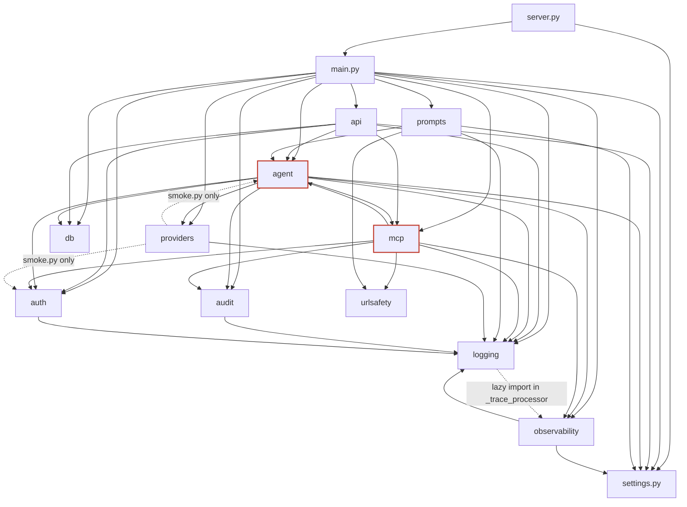
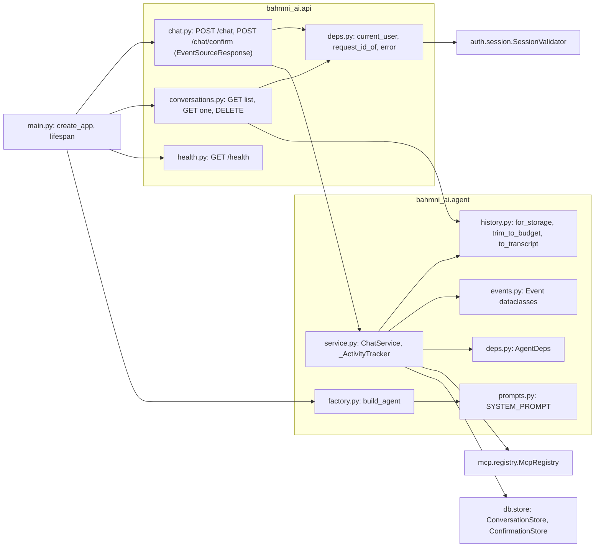
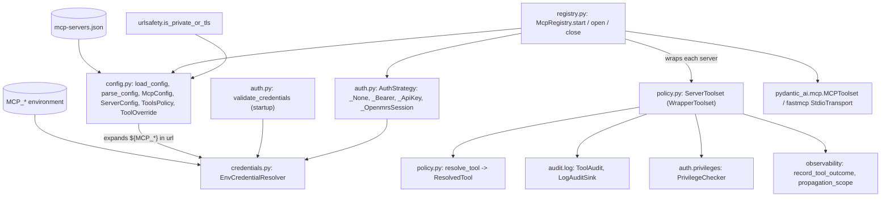
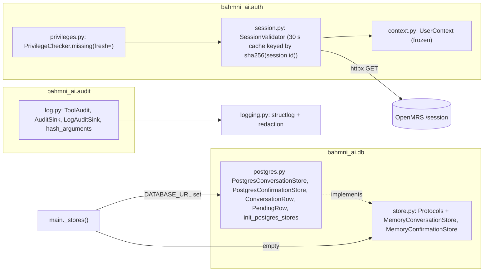
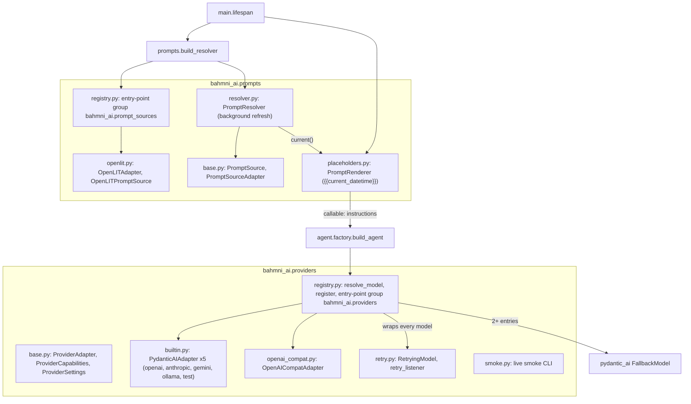
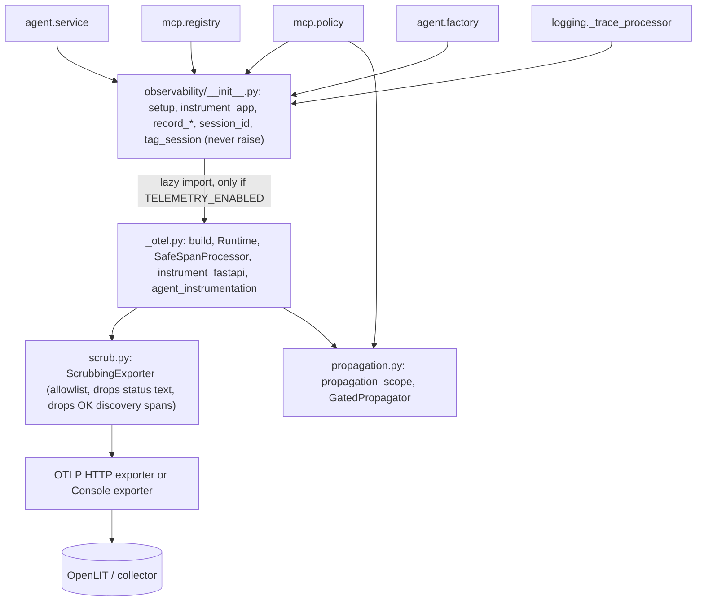

# 02 - Modules and components

Derived from: every file under `src/bahmni_ai/`, `tests/`, `pyproject.toml`. Import edges were computed by parsing the `import` statements of each package (not guessed).

## 1. Package dependency graph

Reading it: `main.py` is the composition root and imports everything. `api` calls `agent`, `auth`, `db`. `agent` and `mcp` depend on each other (red): `agent/history.py` needs `mcp.config.TOOL_SEPARATOR`, while `mcp/policy.py` needs `agent.deps.AgentDeps`. `observability` and `providers` are leaves apart from `logging`/`settings`. `providers/smoke.py` is the only reason `providers` touches `agent` and `auth`.

## 2. Package responsibilities

| Package | Role | Key classes / functions |
|---|---|---|
| `main.py` | Composition root. Builds the FastAPI app, lifespan wiring, fail-closed startup | `create_app`, `_stores`, `_MemoryStores` |
| `server.py` | `python -m bahmni_ai.server`: runs uvicorn | `main` |
| `settings.py` | All configuration from env/`.env` | `Settings`, `get_settings` |
| `logging.py` | JSON logs, secret redaction, trace ids | `configure_logging`, `redact_value` |
| `urlsafety.py` | Where credentials may be sent | `is_private_or_tls` |
| `api/` | HTTP surface | `chat.router`, `conversations.router`, `health.router`, `deps.current_user` |
| `auth/` | Session -> trusted identity -> privileges | `SessionValidator`, `UserContext`, `PrivilegeChecker` |
| `agent/` | One chat turn: agent, streaming, history, events | `ChatService`, `build_agent`, `history`, `events`, `AgentDeps` |
| `mcp/` | Config, credentials, per-run connections, tool policy | `McpConfig`, `EnvCredentialResolver`, `McpRegistry`, `ServerToolset`, `resolve_tool` |
| `db/` | Stores (Protocols + memory + Postgres) | `ConversationStore`, `ConfirmationStore`, `PostgresStores` |
| `audit/` | Structured tool audit | `ToolAudit`, `LogAuditSink` |
| `providers/` | Model provider adapters, retry, fallback | `ProviderAdapter`, `resolve_model`, `RetryingModel`, `OpenAICompatAdapter` |
| `prompts/` | Optional external system prompt + date placeholder | `PromptResolver`, `OpenLITAdapter`, `PromptRenderer` |
| `observability/` | OpenTelemetry facade (only importer of OTel) | `setup`, `ScrubbingExporter`, `propagation_scope` |

## 3. Component diagrams (C4 level 3)

### 3.1 HTTP layer and agent core

`ChatService` is the centre. `chat()` and `confirm()` are async generators of `Event` objects; `api/chat.py::_stream` turns each into an SSE message (`event: <name>`, `data: <json>`). `conversations.py` reaches the store via `request.app.state.chat_service.conversations`. `SYSTEM_PROMPT` in `agent/prompts.py` is the built-in prompt (contains `{{current_datetime}}`).

### 3.2 MCP layer (config, credentials, policy)

- `config.py` defines the strict (`extra="forbid"`, frozen) Pydantic model of `mcp-servers.json`: `ServerConfig`, `ToolsPolicy`, `ToolOverride`, auth variants `NoAuth | BearerAuth | ApiKeyHeaderAuth | OpenmrsSessionAuth`. Server names match `^[a-z][a-z0-9-]*$` so the `server__tool` namespace (`TOOL_SEPARATOR = "__"`) is unambiguous.
- `credentials.py` only resolves names matching `^[A-Z][A-Z0-9_]*$` that start with `MCP_` or are in `CREDENTIAL_ALLOWLIST`. So the file can never read `DATABASE_URL` or `ANTHROPIC_API_KEY`.
- `auth.py` maps each server's auth type to headers. `openmrs-session` forwards the user's session id as `X-OpenMRS-Session-Id` (per-user scope); bearer/api-key are shared service credentials. stdio servers cannot use per-user auth.
- `registry.py` holds stdio servers open for the app lifetime and opens HTTP connections per run with `AsyncExitStack`. One failing server only lands in `OpenedServers.unavailable`.
- `policy.py::ServerToolset` is a `WrapperToolset`: it filters discovery (`get_tools` -> `resolve_tool`), renames tools to `server__tool`, and enforces the call pipeline (see [flow 08b](04-api-and-flows.md#8b-tool-call-policy-pipeline)).

### 3.3 Auth, data stores and audit

`SessionValidator` caches `UserContext` for `SESSION_CACHE_TTL_SECONDS` (30), keyed by `sha256(session id)`; the raw id is only kept inside `UserContext.session_id` (`repr=False`). `PrivilegeChecker.missing` re-validates with the user's session id and rejects if the user uuid changed. `main._stores` picks Postgres when `DATABASE_URL` is set, otherwise in-memory stores with a warning.

### 3.4 Providers and prompts

- `AI_MODEL` is `provider:model[, provider:model ...]`. `resolve_model` builds each via its adapter, wraps it in `RetryingModel`, and returns a `FallbackModel` when there is more than one.
- Built-in adapters: `openai`, `anthropic`, `gemini` (prefix `google`, needs `bahmni-ai[gemini]`), `ollama`, `openai-compat` (`OPENAI_COMPAT_BASE_URL`, optional `OPENAI_COMPAT_API_KEY`), `test` (Pydantic AI fake model). Credentials are read by the provider SDKs from their own standard environment variables, never through `Settings`.
- Retry: statuses 408, 409, 425, 429, 500, 502, 503, 504, 529 and non-HTTP `ModelAPIError`; honours `Retry-After`; only before streaming starts; each wait/resume is surfaced to the UI via the `retry_listener` context variable.
- Prompts: `PromptResolver.current()` is synchronous and I/O-free; a background task refreshes from OpenLIT (`POST {url}/api/prompt/get-compiled`). `PromptRenderer.render` runs on every agent run and fills `{{current_datetime}}` in the clinic `TIMEZONE`.

### 3.5 Observability

The facade never raises and does nothing when `TELEMETRY_ENABLED=false` (OpenTelemetry is imported lazily, only in `_otel.py` and `scrub.py`/`propagation.py`). Every span goes through `ScrubbingExporter`: an attribute allowlist (`gen_ai.`, `bahmni.`, `rpc.`, selected `http.*`, `mcp.method.name`, `error.type`, `session.id`), content keys only when `TELEMETRY_CAPTURE_CONTENT=true`, status descriptions and exception messages removed, routine MCP discovery spans dropped (`errors-only`). W3C `traceparent` is injected into MCP calls only inside `propagation_scope(True)`, i.e. for servers with `propagateTrace: true`. Custom metrics: `bahmni.*` counters for MCP unavailability, chat errors and tool outcomes (`_otel.py`).

## 4. Tests

`tests/` (206 passed, 7 skipped on this tree). CI requires coverage >= 90 % (`validate_pr.yml`).

| File | Covers |
|---|---|
| `test_auth.py` | Session validation, spoofed identity headers ignored, 401/403/502 mapping, cache and `fresh` bypass, per-session cache keys, malformed ids |
| `test_hardening.py` | Fixture config `tests/fixtures/mcp-servers.example.json` is valid, session ids never appear in logs/responses, parallel users never see each other's session |
| `test_config_credentials.py`, `test_registry_policy.py` | `mcp-servers.json` validation, credential rules, tool visibility/policy, real stub MCP servers over HTTP and stdio (`tests/stubs.py`, `tests/stdio_stub.py`, FastMCP) |
| `test_chat_api.py`, `test_activity.py` | SSE endpoints, confirmation flow, activity events |
| `test_db_store.py` | Memory store and, if `TEST_DATABASE_URL` is set, Postgres store; SQLite otherwise |
| `test_providers.py`, `test_provider_switch.py` | Adapters, retry, fallback |
| `test_prompt_hub.py`, `test_placeholders.py` | Prompt hub and date placeholder |
| `test_observability.py`, `tests/telemetry_support.py` | Scrubbing, propagation gate, failure isolation (largest file, 810 lines) |
| `test_startup.py`, `test_health_and_logging.py` | Fail-closed startup (missing config/credential/unknown provider), stdio gating and secret isolation for subprocesses, health, log redaction, token counts in logs |
| `test_live_providers.py` | Marked `live`: real provider calls, skipped without `LIVE_PROVIDER_MODELS` |

`tests/conftest.py` isolates tests from any developer `.env` (per the CHANGELOG).

## Observations

- `agent` <-> `mcp` coupling could be broken by moving `TOOL_SEPARATOR`/`split_name` into a small shared module.
- `McpRegistry` takes `connect_timeout_seconds` but `main.py` does not pass it, so the 5 s default is fixed.
- `ChatService.MAX_MESSAGE_CHARS` (8000) and `ChatRequest.message max_length=8000` duplicate the same limit.
- `ai_request_timeout_seconds` is passed to `build_agent` twice (positional and inside `ProviderSettings`); harmless.
- `PostgresConversationStore.save` does not touch `title` for existing live rows (only set on creation), matching the Protocol docstring.
