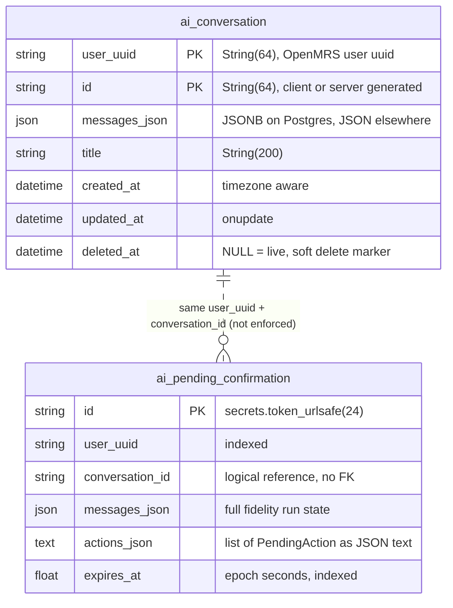
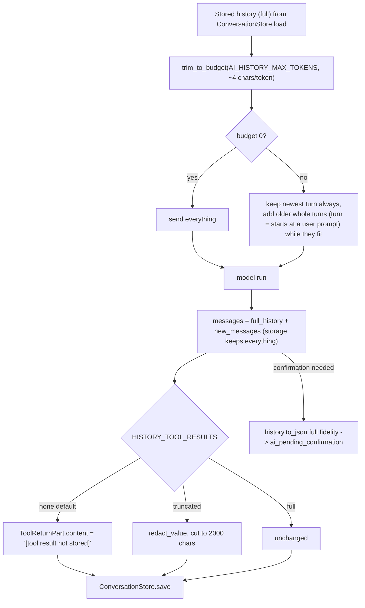
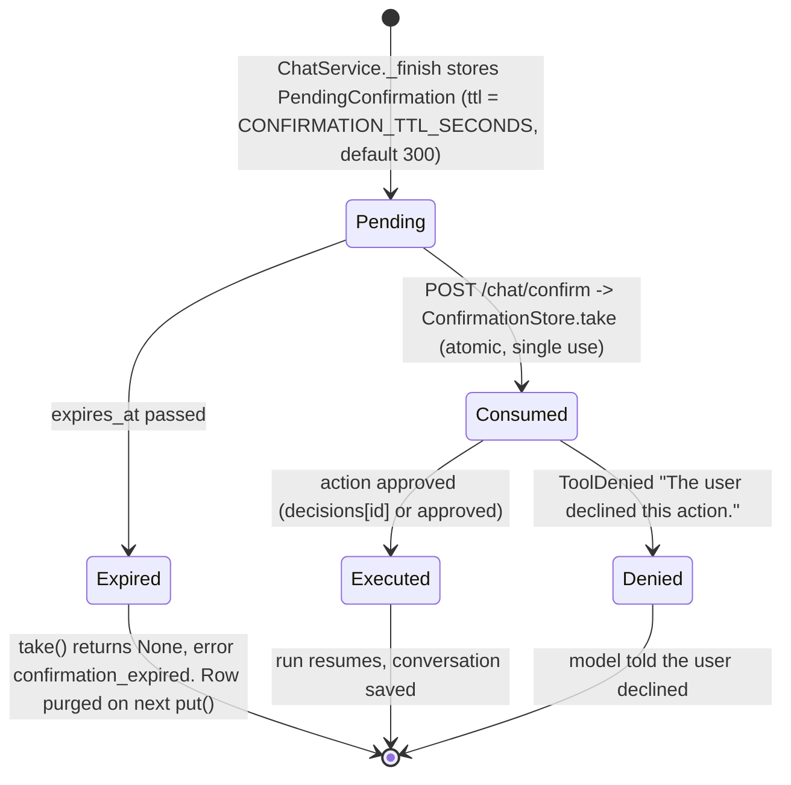
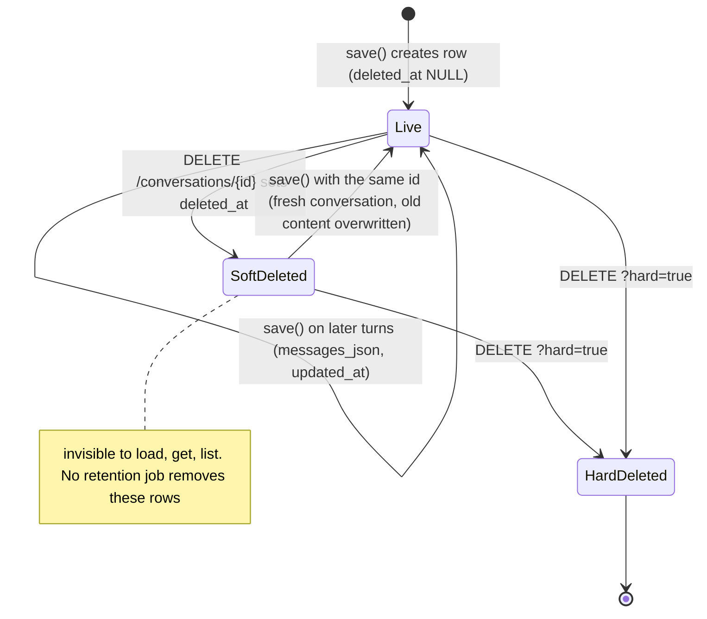
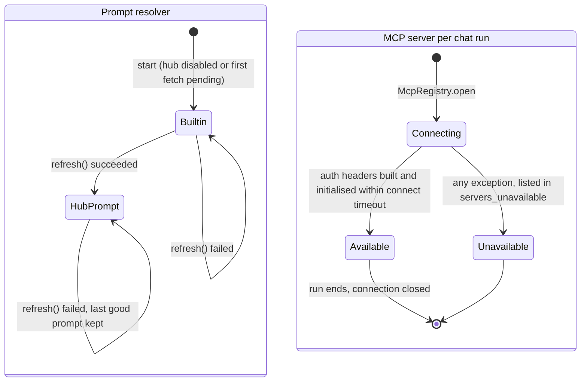

# 03 - Data model

Derived from: `src/bahmni_ai/db/postgres.py`, `db/store.py`, `agent/history.py`, `agent/service.py`, `docker-compose.dev.yml`.

## 1. Plain language

The service keeps two small things in its **own** Postgres database (never the OpenMRS one): the chat history of each user, and confirmations that are waiting for the user's click. It stores no credentials and no session ids. The history is only model context, never a source of authorisation. Everything is looked up by the OpenMRS user uuid first, so one user can never reach another's rows.

## 2. Tables

Two tables, declared with SQLAlchemy 2 declarative models (`Base`, `ConversationRow`, `PendingRow`) and created by `Base.metadata.create_all` at startup. **There are no migrations** (no Alembic/Liquibase/Flyway files in the repo).

### `ai_conversation` (`ConversationRow`)

| Column | Type | Notes |
|---|---|---|
| `user_uuid` | `String(64)` PK (part 1) | OpenMRS user uuid |
| `id` | `String(64)` PK (part 2) | Conversation id. Server-generated `uuid4().hex`, or client-supplied matching `^[A-Za-z0-9_-]+$` (max 64) |
| `messages_json` | JSONB on Postgres, JSON elsewhere | Pydantic AI `ModelMessage` list as JSON, tool results redacted per `HISTORY_TOOL_RESULTS` |
| `title` | `String(200)` | First user message, max 80 chars (`history.title_of`); set only at creation |
| `created_at`, `updated_at` | `DateTime(timezone=True)` | `updated_at` has `onupdate`. Note: `save()` of an existing live row only sets `messages_json`; the ORM `onupdate` refreshes `updated_at` |
| `deleted_at` | `DateTime(timezone=True)` NULL | Soft delete marker |

Index: `ix_ai_conversation_user_updated (user_uuid, updated_at)`.

### `ai_pending_confirmation` (`PendingRow`)

| Column | Type | Notes |
|---|---|---|
| `id` | `String(64)` PK | `secrets.token_urlsafe(24)` (`store.new_id`) |
| `user_uuid` | `String(64)` indexed | Owner; `take()` filters on it |
| `conversation_id` | `String(64)` | Logical reference only (no foreign key) |
| `messages_json` | JSON/JSONB | **Full-fidelity** run state (`history.to_json`), not redacted |
| `actions_json` | `Text` | JSON list of `PendingAction{id, server, tool, arguments}` |
| `expires_at` | `Float` indexed | Epoch seconds, `now + CONFIRMATION_TTL_SECONDS` (300) |

## 3. ER diagram

There is no database-level relationship: `ai_pending_confirmation.conversation_id` points at a conversation by convention, and a confirmation can outlive or precede the conversation row (a brand-new conversation is only saved after the turn finishes without confirmation needed, see `ChatService._finish`).

## 4. Store contracts

`db/store.py` defines two `Protocol`s, each with an in-memory and a Postgres implementation:

| Protocol | Memory | Postgres | Behaviour |
|---|---|---|---|
| `ConversationStore` (`load`, `save`, `list`, `get`, `delete`) | `MemoryConversationStore` | `PostgresConversationStore` | Every call is owner scoped. Soft-deleted rows are invisible to all methods. Saving to a soft-deleted id resets the row (fresh conversation). |
| `ConfirmationStore` (`put`, `take`) | `MemoryConfirmationStore` | `PostgresConfirmationStore` | `take` is single use: Postgres does one `DELETE ... WHERE id AND user_uuid RETURNING`, so two instances cannot both win. Unknown id and someone else's id are indistinguishable (`None`). `put` first deletes expired rows. |

`init_postgres_stores(database_url)` creates the async engine (`pool_pre_ping=True`) and calls `create_all`. Any SQLAlchemy async dialect works; tests use SQLite via `aiosqlite` (`tests/test_db_store.py` parametrises sqlite and, if `TEST_DATABASE_URL` is set, postgres).

## 5. What goes into `messages_json`

Pydantic AI `ModelMessagesTypeAdapter` JSON: user prompts, assistant text, tool calls, tool returns, timestamps, and the stored `conversation_id` (the telemetry session id). `agent/history.py` operates on it:

`to_transcript` (used by `GET /conversations/{id}`) shows only user text, assistant text and the names of tools used, never tool arguments or results, system prompts or retry prompts.

## 6. Lifecycles

### Confirmation

### Conversation

### Prompt text and MCP server availability (non-persisted)

## 7. Other data (not in the database)

| Data | Where | Lifetime |
|---|---|---|
| Session -> `UserContext` | `SessionValidator._cache` (memory), key sha256(session id) | 30 s, max 1024 entries, cleared when full |
| Tool audit trail | structured log line `tool_audit` on stdout | Whatever the log pipeline keeps |
| Hub prompt text | `PromptResolver._hub_text` (memory) | Until next refresh |
| Telemetry | OpenLIT/ClickHouse (separate deployment, `TRACE_RETENTION_HOURS` 168, `METRIC_RETENTION_HOURS` 720 by default) | Retention env vars in `deploy/openlit/docker-compose.yml` |

## Observations

- No migration tool: schema changes will not apply to an existing database; `create_all` never alters tables.
- Soft-deleted conversations and expired confirmations have no scheduled cleanup (expired confirmations are removed lazily on the next `put`).
- Messages are stored as one JSON document per conversation and rewritten in full each turn; fine for small chats, grows linearly with history (storage keeps everything even though the model sees a trimmed window).
- The pending confirmation row contains un-redacted tool results for up to 5 minutes.
