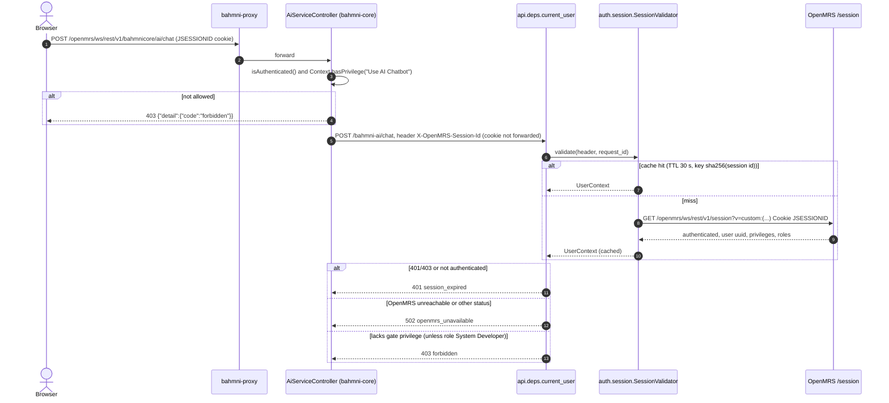
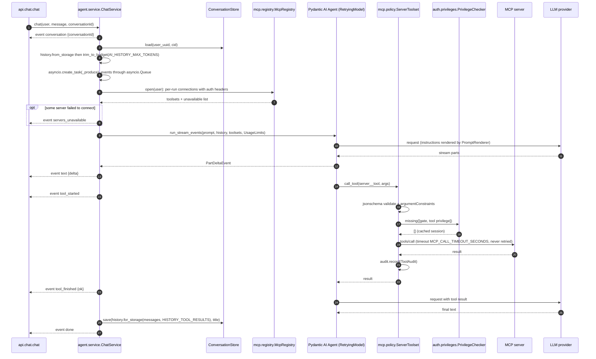
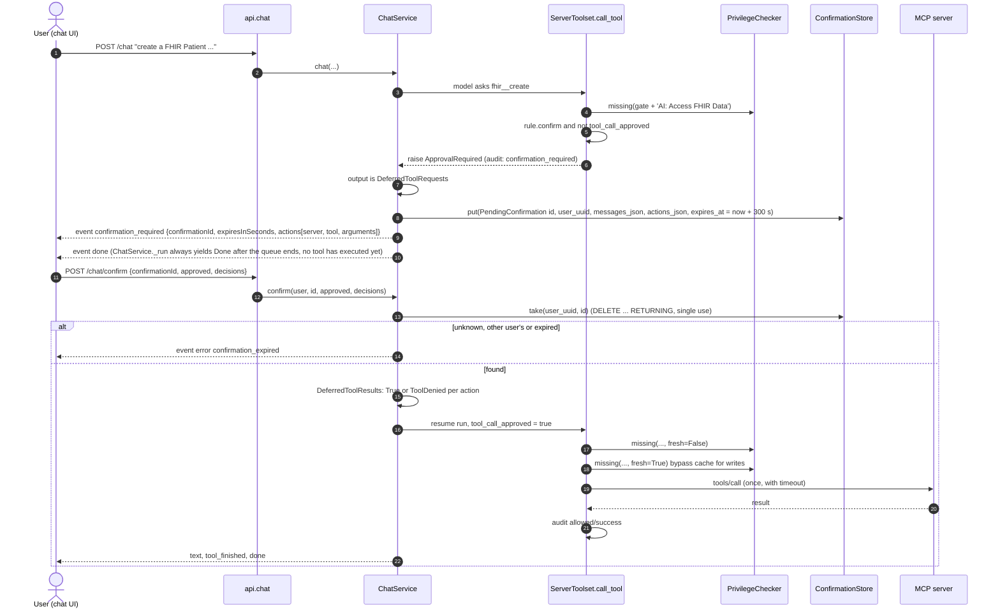
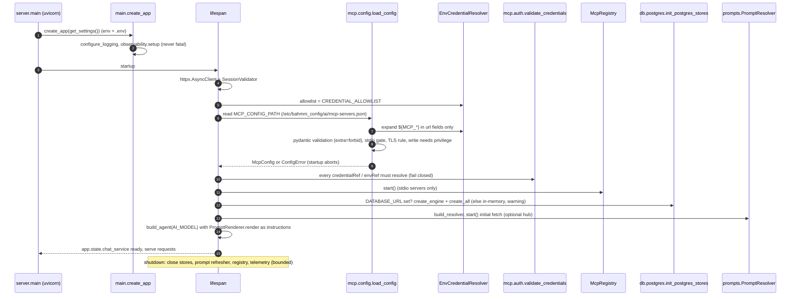
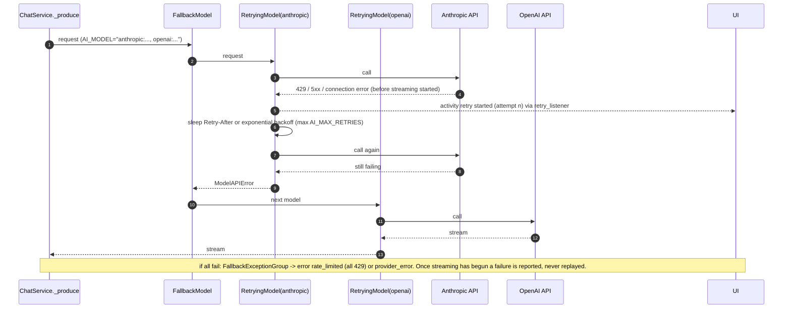
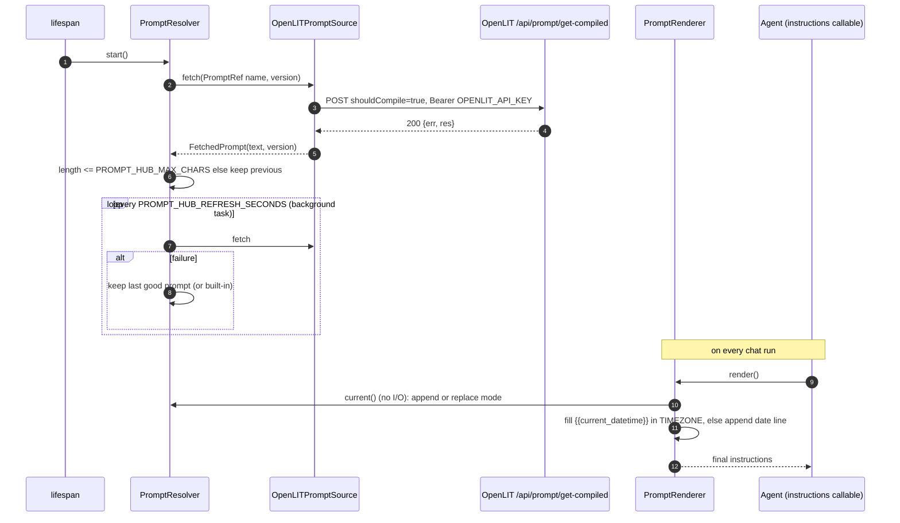
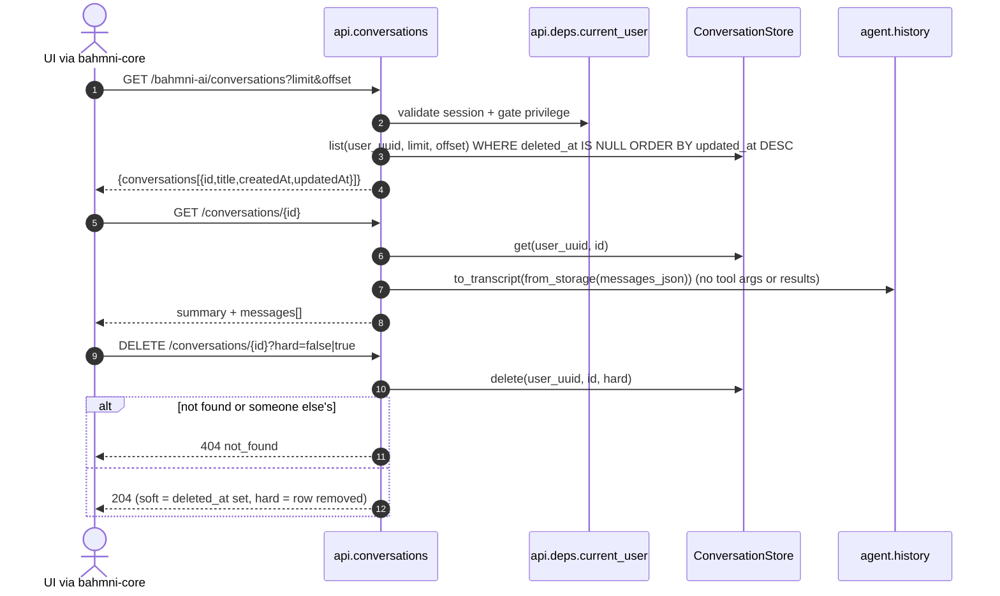
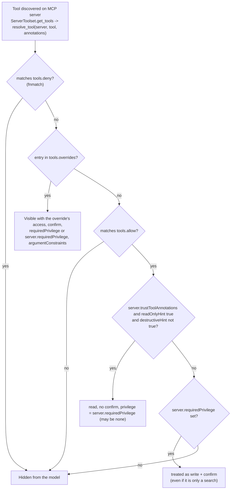
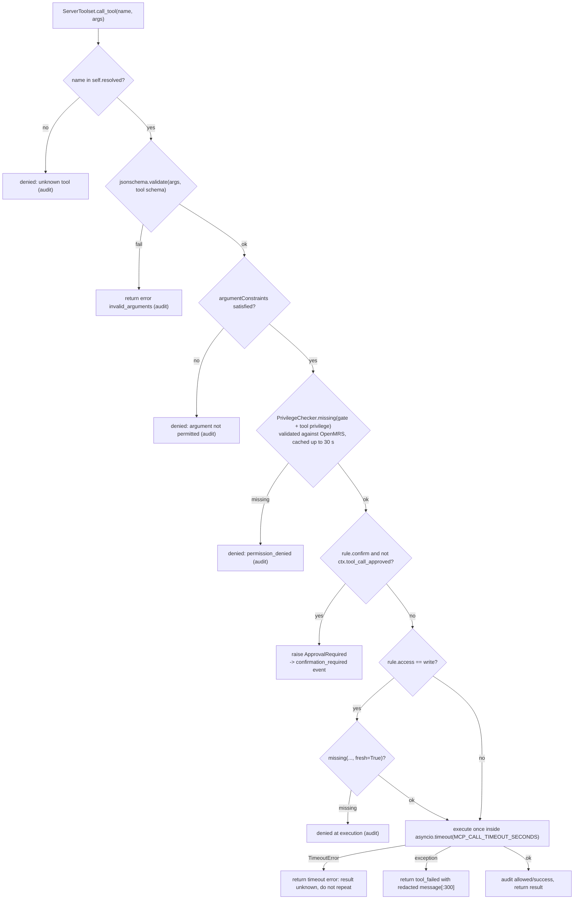
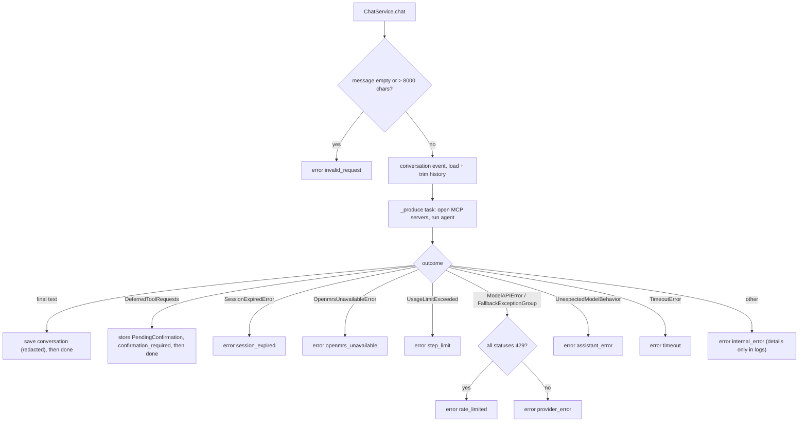

# 04 - API and key flows

Derived from: `api/chat.py`, `api/conversations.py`, `api/health.py`, `api/deps.py`, `agent/service.py`, `agent/events.py`, `mcp/policy.py`, `mcp/registry.py`, `auth/session.py`, `main.py`, `providers/*`, `prompts/*`; bahmni-core `AiServiceController.java` for the front proxy.

## 1. Plain language

The browser calls `bahmni-core`; `bahmni-core` calls these endpoints. Chat answers are Server-Sent Events (a long-lived HTTP response with a stream of small named events). Conversation list/read/delete are normal JSON calls. Everything except health needs the session header.

## 2. Public surface

Prefix = `SERVICE_PATH` (`/bahmni-ai`). Router wiring is in `main.create_app`.

| Method and path | Body / params | Response | Auth |
|---|---|---|---|
| `GET /bahmni-ai/health` | none | `{"status":"UP"}` (constant) | none |
| `POST /bahmni-ai/chat` | `{message (<=8000), conversationId? (<=64, [A-Za-z0-9_-])}`; extra fields rejected | SSE stream | session + gate privilege |
| `POST /bahmni-ai/chat/confirm` | `{confirmationId (<=128), approved=true, decisions{actionId: bool}}` | SSE stream | session + gate privilege |
| `GET /bahmni-ai/conversations` | `limit` 1..100 (20), `offset` >=0 | `{conversations:[{id,title,createdAt,updatedAt}], limit, offset}` | same |
| `GET /bahmni-ai/conversations/{id}` | path id | summary + `messages:[{role,text,timestamp,tools?:[{server,tool}]}]` | same |
| `DELETE /bahmni-ai/conversations/{id}` | `?hard=false|true` | 204, or 404 `not_found` | same |

"Session" means header `X-OpenMRS-Session-Id` (constant `SESSION_HEADER` in `mcp/auth.py`). Auth failures are `HTTPException` with body `{"detail":{"code","message"}}`: `401 session_expired`, `403 forbidden`, `502 openmrs_unavailable`, `404 not_found`. Other request validation errors use FastAPI's default 422 body (not customised; **Unverified** shape because no override exists in the code).

No CORS middleware is installed (`test_no_cors_headers_and_unauthenticated_rejected`): browsers are not meant to call it.

The bahmni-core proxy (`AiServiceController`, mapping `/rest/v1/bahmnicore/ai`) exposes `GET /health`, `POST /chat`, `POST /chat/confirm`, `GET /conversations`, `GET /conversations/{id}`, `DELETE /conversations/{id}`. It checks `Context.isAuthenticated() && Context.hasPrivilege("Use AI Chatbot")` first (403 otherwise), forwards only the `JSESSIONID` value (as `X-OpenMRS-Session-Id`) and never the caller's `Authorization` or other cookies. (Header and privilege behaviour read from the Java source; streaming behaviour of `AiServiceClient` is **Unverified**.)

### SSE events (`agent/events.py`)

| Event | Payload | When |
|---|---|---|
| `conversation` | `{conversationId}` | first event of every turn |
| `servers_unavailable` | `{servers[]}` | some MCP servers could not be reached this turn |
| `activity` | `{id, kind: model|thinking|tool|retry, state: started|finished, server?, tool?, attempt?}` | temporary progress lines (`UI_ACTIVITY_EVENTS`); never content |
| `text` | `{delta}` | streamed answer text |
| `tool_started` / `tool_finished` | `{server, tool}` / `+ ok` | a tool call begins/ends; `ok=false` if the result is `{"error": ...}` |
| `confirmation_required` | `{confirmationId, expiresInSeconds, actions[{id,server,tool,arguments}]}` | a write needs approval; no tool has run |
| `error` | `{code, message}` | see below |
| `done` | `{}` | always last (also follows `confirmation_required`; not after `error`) |

Error codes emitted by `ChatService`: `invalid_request`, `confirmation_expired`, `session_expired`, `openmrs_unavailable`, `step_limit`, `rate_limited`, `provider_error`, `assistant_error`, `timeout`, `internal_error`. Messages are fixed strings; provider/tool error text is never echoed to the client.

Limits: `AI_MAX_TOOL_STEPS` (10) maps to `UsageLimits.request_limit`; `AI_MAX_TOTAL_TOKENS` (0 = none) to `total_tokens_limit`; `MCP_CALL_TIMEOUT_SECONDS` (30) per tool call; `AI_REQUEST_TIMEOUT_SECONDS` (60) per model call.

### Request lifecycle (controller -> service -> store)

`api/chat.py` (`chat`, `confirm`) -> `ChatService.chat/confirm` (`agent/service.py`) -> `McpRegistry.open` + Pydantic AI agent -> `ServerToolset.call_tool` (`mcp/policy.py`) -> MCP server; persistence via `ConversationStore` / `ConfirmationStore` (`db/`). There is no DAO layer: stores are used directly by `ChatService` and the conversations router.

## 3. Sequence diagrams

### 7a. Login: session validation

bahmni-core has already authenticated the user. bahmni-ai still calls OpenMRS because "the compose network is not a trust boundary" (`docs/PLAN.md`). The privileges and roles come from the OpenMRS response, never from the request or the model.

### 7b. Main workflow: chat turn with a read tool

### 7c. Write with confirmation

The model asking is not consent. The decision to run a write is made by the user through `/chat/confirm`, validated against the stored, user-bound, single-use record, and then the privilege is re-checked uncached right before execution.

### 7d. Startup and config loading

Any `ConfigError`, `CredentialError`, `ModelConfigError` or `PromptSourceError` aborts startup (nothing half-configured serves requests). Telemetry setup failure does not.

### 7e. Provider retry and fallback

### 7f. Prompt hub refresh and rendering

### 7g. Conversation list, read, delete

## 4. Flowcharts

### 8a. Tool visibility (discovery)

Discovery grants nothing: a tool is visible only if config says so. Note the shipped `fhir` server uses `overrides` (so `allow` is empty), and `confluence` uses `allow: ["*"]` without `trustToolAnnotations`, which lands every tool in the "write + confirm" branch.

### 8b. Tool call policy pipeline

### 8c. Chat turn outcome and error mapping

### 8d. History trimming and storage redaction

See [03-data-model.md](03-data-model.md#5-what-goes-into-messages_json).

## 5. State diagrams

Confirmation, conversation and prompt/server states are in [03-data-model.md](03-data-model.md#6-lifecycles).

## 6. Security-relevant behaviours

- Identity is taken only from the validated session. `test_spoofed_identity_headers_are_ignored` covers `X-User-Id`-style headers.
- A validated session id longer than 256 chars, non-printable, empty or containing `;` is rejected before any OpenMRS call (`SessionValidator.validate`).
- The user's session id is sent to MCP servers only for `auth.type = "openmrs-session"` and only over https/local http (`ServerConfig._transport_fields`).
- Trace context goes to MCP servers only when `propagateTrace: true`.
- A tool that times out returns `timeout` with "result is unknown, do not repeat" and is not retried (writes are not assumed idempotent).

## Observations

- The SSE stream always ends with `done` except after `error`; the activity docstring says the UI clears activities on `done`, `error` or `confirmation_required`. Because `done` follows `confirmation_required`, a client that waits for `done` still works.
- `chat()` yields `ConversationStarted` before loading history, so a failing store load surfaces as a stream error after the first event rather than an HTTP error.
- A client can choose any `conversationId`; isolation comes from the `(user_uuid, id)` primary key, not from the id's secrecy.
