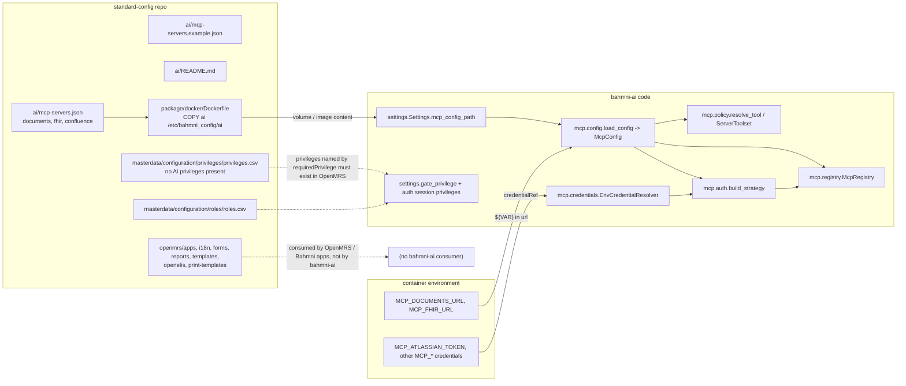

# 05 - Config-to-code mapping (standard-config -> bahmni-ai)

Derived from: `standard-config/ai/{mcp-servers.json,mcp-servers.example.json,README.md}`, `standard-config/package/docker/{Dockerfile,start.sh}`, `package/helm/*`, `scripts/package.sh`, `masterdata/configuration/{privileges,roles}`; and in this repo `settings.py`, `mcp/config.py`, `mcp/credentials.py`, `mcp/auth.py`, `mcp/registry.py`, `mcp/policy.py`, `main.py`, `tests/fixtures/mcp-servers.example.json`.

## 1. Plain language

standard-config is a big folder of clinic configuration for many Bahmni apps. **Only one part of it, the `ai/` folder, is read by bahmni-ai.** That folder holds a single JSON file saying which MCP tool servers the assistant may talk to, how to authenticate to them (by *reference* to an environment variable, never a secret), and which of their tools are visible, which are writes, which need confirmation and which OpenMRS privilege each needs. Everything else in standard-config (apps, forms, dashboards, reports, locale, print templates, master data) is consumed by OpenMRS and the Bahmni front ends. bahmni-ai neither reads nor depends on it.

## 2. Mapping diagram

## 3. How it is delivered and loaded at runtime

1. `standard-config/package/docker/Dockerfile` builds an `alpine:3.20.0` image that copies `openmrs`, `masterdata`, `openelis`, `print-templates` and `ai` into `/etc/bahmni_config/<area>`. (The `COPY ai ...` line is an uncommitted change in standard-config's working tree, as is the whole `ai/` folder: `git status` shows `?? ai/`.)
2. `start.sh` copies `/etc/bahmni_config` to `/usr/local/` and sleeps forever. In bahmni-docker the config is a volume (`${CONFIG_VOLUME}`) mounted read-only at `/etc/bahmni_config/` in the consuming containers (pattern from `docs/PLAN.md` and the compose file). The Helm chart (`package/helm/templates`: `deployment.yaml`, `rbac.yaml`, `volumes/bahmni-config.yaml`, ...) deploys the standard-config image and its volume; it has no bahmni-ai wiring (**no `bahmni-ai` references anywhere under `package/`**).
3. bahmni-ai reads the file **once at startup** from `MCP_CONFIG_PATH` (default `/etc/bahmni_config/ai/mcp-servers.json`, also set by the image `ENV`). There is no hot reload: a config change needs a container restart.
4. Load path (`main.lifespan`): `load_config` -> `json.loads` -> expand `${MCP_*}` in `url` fields only -> Pydantic `McpConfig` validation -> stdio gate -> `validate_credentials` (every `credentialRef`/`envRefs` value must resolve) -> `McpRegistry`.

## 4. Field-by-field: `ai/mcp-servers.json` -> code

| Config key | Consumed by | Effect |
|---|---|---|
| `mcpServers.<name>` | `McpConfig` (`mcp/config.py`) | Server name; must match `^[a-z][a-z0-9-]*$`; used as the tool namespace `<name>__<tool>` |
| `url` | `config._expand_urls`, `McpRegistry._http` | `${VAR}` expanded from the environment (only `MCP_*` or `CREDENTIAL_ALLOWLIST` names; must be set). Must be http(s); with auth it must pass `is_private_or_tls` |
| `transport` | `ServerConfig._transport_fields`, `McpRegistry` | `streamable-http` (default) or `stdio` (needs `MCP_ALLOW_STDIO=true`) |
| `command`, `args`, `envRefs` | `McpRegistry.start` | stdio only. `envRefs` maps subprocess env name -> credential reference |
| `auth.type = none` | `mcp.auth._None` | no headers |
| `auth.type = bearer` + `credentialRef` | `mcp.auth._Bearer`, `EnvCredentialResolver.resolve` | `Authorization: Bearer <env value>`; shared connection scope |
| `auth.type = api-key-header` + `credentialRef` + `header` | `mcp.auth._ApiKey` | custom header with the env value |
| `auth.type = openmrs-session` | `mcp.auth._OpenmrsSession` | forwards the user's session as `X-OpenMRS-Session-Id`; per-user, never for stdio |
| `requiredPrivilege` (server) | `resolve_tool`, `ServerToolset.call_tool`, `PrivilegeChecker` | default OpenMRS privilege for tools matched by `allow` (and overrides without their own) |
| `tools.allow` / `tools.deny` | `resolve_tool` (`fnmatch` patterns) | visibility. `deny` wins; unmatched -> hidden (`default` can only be `"deny"`) |
| `tools.overrides.<tool>` | `ToolOverride`, `resolve_tool` | `access` read/write, `confirm`, `requiredPrivilege`, `argumentConstraints`. Write requires `confirm: true` and a privilege (tool or server) or config validation fails |
| `tools.overrides.<tool>.argumentConstraints` | `ServerToolset.call_tool` | `{"arg": ["allowed", ...]}`; value compared as string |
| `trustToolAnnotations` | `resolve_tool` | believe the server's `readOnlyHint` (first-party only) |
| `propagateTrace` | `propagation_scope` in `ServerToolset`, `main.py` startup log | send `traceparent` to this server |

## 5. What the shipped config declares (`standard-config/ai/mcp-servers.json`)

| Server | URL source | Auth | Server privilege | Tools |
|---|---|---|---|---|
| `documents` | `${MCP_DOCUMENTS_URL}` | none | `AI: Search Documents` | allow `list_documents`, `read_document`, `search_documents`; `trustToolAnnotations: true` (so read-only hinted tools run without confirmation) |
| `fhir` | `${MCP_FHIR_URL}` | `openmrs-session` | `AI: Access FHIR Data` | deny `delete`; overrides: `get_capabilities`, `search`, `read`, `get_user` = read; `create`, `update` = write + confirm. No `trustToolAnnotations` |
| `confluence` | hard-coded `https://mcp.atlassian.com/v2/mcp` | bearer `MCP_ATLASSIAN_TOKEN` | `AI: Search Documents` | allow `*`; no annotation trust -> all tools are write + confirm |

Needed environment (bahmni-docker compose passes them): `MCP_DOCUMENTS_URL`, `MCP_FHIR_URL`, `MCP_ATLASSIAN_TOKEN` (and `MCP_DOCUMENTS_TOKEN`, which the shipped config does not use). If any referenced variable or credential is unset, **the service refuses to start** (so the shipped config requires all three even if the profile is only meant for one server; bahmni-docker defaults them to empty strings, which also fail the "is set" check: `resolve_plain` rejects empty values). The empty-default behaviour is derived from `credentials.py` and the compose file; I did not start the stack (**Unverified at runtime**).

`standard-config/ai/mcp-servers.example.json` (documents/jira/openmrs) has JSON content identical to `tests/fixtures/mcp-servers.example.json`, which `test_shipped_sample_config_is_valid` validates: a copy, so the two can drift.

## 6. Other bahmni-ai configuration that standard-config does not control

| Source | Examples |
|---|---|
| Container environment (`Settings`) | `AI_MODEL`, provider keys, `OPENMRS_URL`, `DATABASE_URL`, `GATE_PRIVILEGE`, `HISTORY_TOOL_RESULTS`, `TELEMETRY_*`, `PROMPT_HUB_*`, `TIMEZONE`, timeouts |
| bahmni-docker | `.env` and `bahmni-ai` service environment; `BAHMNI_AI_MCP_ENV_FILE` for secrets |
| OpenMRS | The privilege **names** the config mentions must exist and be granted to roles |
| bahmni-core (`ai.service.url`) | Where the front proxy sends traffic (**Unverified** here: the template lives in `openmrs-distro-bahmni`, which I did not find containing `ai.service`) |

## 7. The rest of standard-config (no bahmni-ai consumer)

| Area (path) | What it configures | Consumer |
|---|---|---|
| `openmrs/apps/*` (`home`, `clinical`, `registration`, `ipd`, `adt`, `appointments`, `orders`, `ot`, `reports`, `admin`, ...) | Bahmni app dashboards, extensions, forms layout | Bahmni apps front end (**Unverified**, Bahmni convention) |
| `openmrs/i18n/*` | Locale strings | Bahmni front ends (**Unverified**) |
| `openmrs/{migrations,beanshell,encounterModifier,obscalculator,rulesengine,ordertemplates,patientMatchingAlgorithm,...}` | OpenMRS-side extensions and Liquibase | OpenMRS / bahmni-core (**Unverified**) |
| `masterdata/configuration/*` (`privileges`, `roles`, `concepts`, `locations`, `drugs`, `globalproperties`, `bahmniforms`, ...) | OpenMRS Initializer CSV domains | OpenMRS Initializer (**Unverified**) |
| `openelis/*` | Lab config | OpenELIS |
| `print-templates/*` | Print templates | template-service (`docs/PLAN.md`) |
| `package/docker`, `package/helm`, `scripts/*` | Packaging | build/deploy |

Privileges: `masterdata/configuration/privileges/privileges.csv` and `roles/roles.csv` contain **no** `Use AI Chatbot` or `AI: ...` entries, so nothing in standard-config creates or grants the privileges the shipped `ai/mcp-servers.json` depends on. Also, `scripts/package.sh` zips only `openmrs/*`, `migrations/*`, `openelis/*` (not `ai`), so `default_config.zip` does not carry the AI config.

## Observations

- The shipped `ai/` folder and the `COPY ai` Dockerfile change are uncommitted in standard-config.
- A single bad entry (or an unset `MCP_*` variable) prevents the **whole** assistant from starting; there is no per-server "skip if unconfigured".
- Config is startup-only; changing a tool policy needs a restart.
- `confluence` has a hard-coded URL while others use variables: inconsistent, and its token is mandatory at startup.
