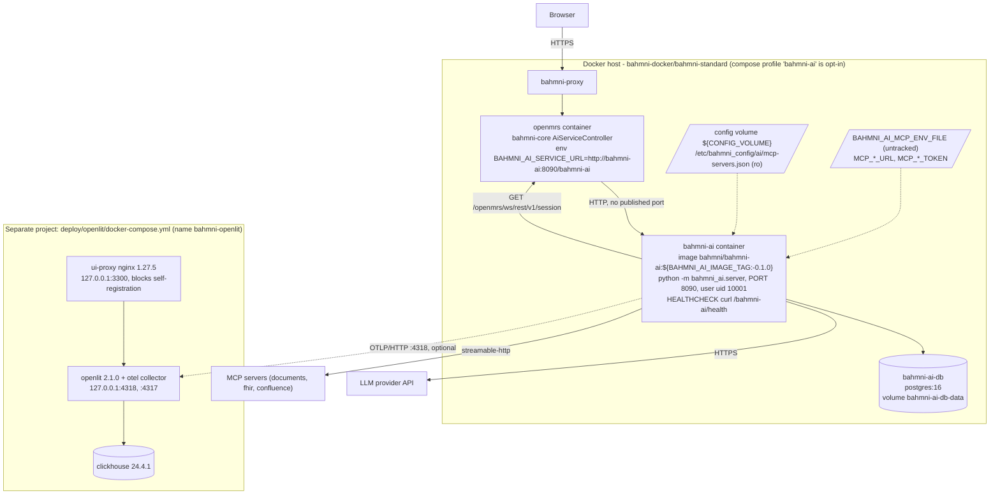
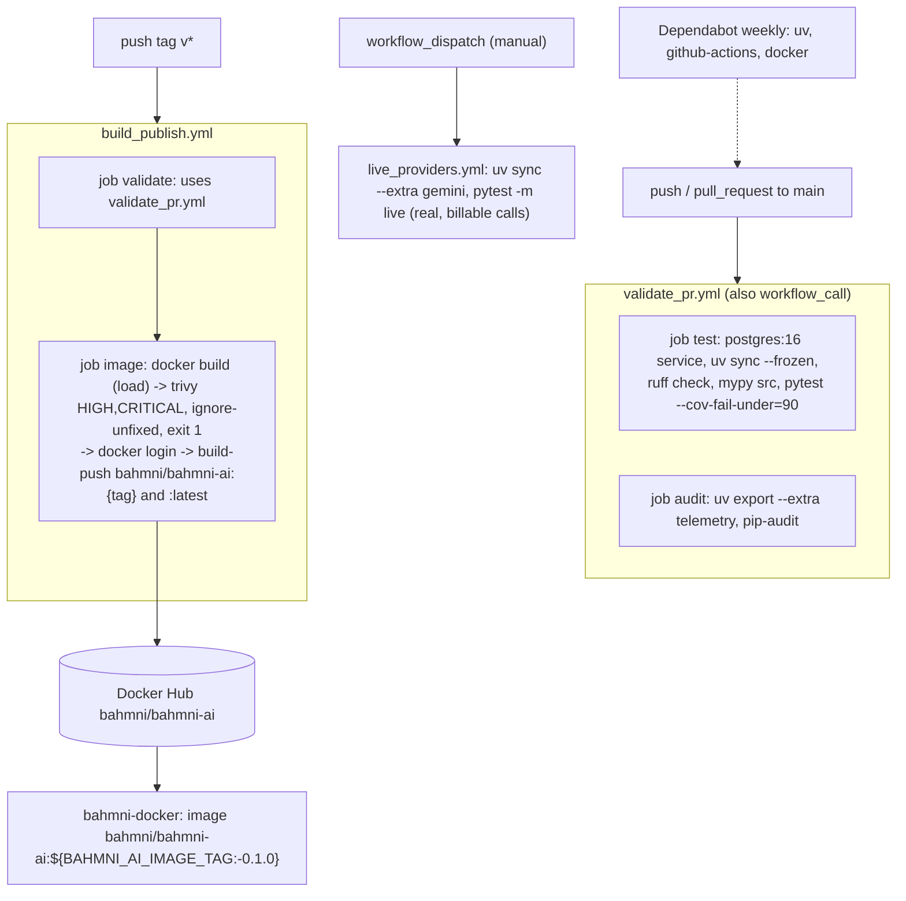

# 06 - Deployment, infrastructure and CI/CD

Derived from: `Dockerfile`, `.dockerignore`, `docker-compose.dev.yml`, `.env.example`, `deploy/openlit/*`, `.github/workflows/*.yml`, `.github/dependabot.yml`, `pyproject.toml`, `../bahmni-docker/bahmni-standard/{docker-compose.yml,.env}` (outside the two repos; quoted lines only).

## 1. Plain language

bahmni-ai ships as one small Docker image. Inside Bahmni it is an optional compose profile (`bahmni-ai`) that adds the service plus its own Postgres. Nothing is published on a host port; only OpenMRS talks to it. Telemetry (OpenLIT) is a separate, optional stack. CI runs lint, types, tests with a real Postgres, and a dependency audit; pushing a `v*` git tag scans and publishes the image.

## 2. Image (`Dockerfile`)

- Stage 1 `python:3.12-slim@sha256:...` + `uv 0.11.25`: `uv sync --frozen --no-dev --no-editable --extra telemetry` into `/app/.venv`.
- Stage 2 same pinned base: installs `curl` (healthcheck), creates system user `bahmniai` (uid 10001), copies the venv, `ENV HOST=0.0.0.0 PORT=8090 MCP_CONFIG_PATH=/etc/bahmni_config/ai/mcp-servers.json`, `EXPOSE 8090`, `HEALTHCHECK curl -fsS http://127.0.0.1:${PORT}/bahmni-ai/health` every 30 s, `CMD ["python","-m","bahmni_ai.server"]`.
- `.dockerignore` excludes `.venv`, `.git`, `tests`, `.env`, `__pycache__`. The `gemini` extra is **not** installed in the image (only `telemetry`).

## 3. Deployment diagram

| Unit | Source | Notes |
|---|---|---|
| `bahmni-ai` | bahmni-docker compose, profile `bahmni-ai` | env: `PORT`, `OPENMRS_URL=http://${OPENMRS_HOST}:${OPENMRS_PORT}`, `AI_MODEL`, provider keys, `MCP_*`, `DATABASE_URL`, `TELEMETRY_*`, `PROMPT_HUB_*`, `OPENLIT_API_KEY`; `env_file: BAHMNI_AI_MCP_ENV_FILE` (untracked) |
| `bahmni-ai-db` | `postgres:16`, volume `bahmni-ai-db-data` | dedicated DB (`BAHMNI_AI_DB_*`) |
| standalone dev | `docker-compose.dev.yml` | `bahmni-ai` on `8090:8090` + `bahmni-ai-db`; mounts `./dev-config` (empty `mcpServers`) at `/etc/bahmni_config/ai:ro`; `AI_MODEL` defaults to `test`; OpenMRS at `host.docker.internal:8080` |
| OpenLIT stack | `deploy/openlit/docker-compose.yml` (project `bahmni-openlit`) | `clickhouse/clickhouse-server:24.4.1` (no published ports), `ghcr.io/openlit/openlit:2.1.0` (OTLP 4318/4317 bound to `127.0.0.1`), `nginx:1.27.5-alpine` `ui-proxy` on `127.0.0.1:3300` that blocks OpenLIT's self-registration; `harden.py` and `purge.py` are operator scripts |
| Kubernetes | none for bahmni-ai | standard-config's Helm chart only deploys the config image/volume; no bahmni-ai manifests anywhere in the two repos |

Health: `GET /bahmni-ai/health` (constant `UP`). Ports: 8090 (service), 5432 (Postgres, internal). No queues, caches or other brokers exist.

Traffic path in a Bahmni deployment: Browser -> `bahmni-proxy` -> `openmrs` (bahmni-core `AiServiceController`) -> `bahmni-ai:8090/bahmni-ai/*`; `BAHMNI_AI_SERVICE_URL` is `http://bahmni-ai:${BAHMNI_AI_PORT}/bahmni-ai` in bahmni-docker `.env`. SSE must not be buffered by the proxy chain (`docs/REPOS.md` lists this as a manual check; the service sets `Cache-Control: no-cache` and `X-Accel-Buffering: no`).

## 4. CI/CD pipeline

| Workflow | Trigger | Steps |
|---|---|---|
| `validate_pr.yml` | `pull_request`, push to `main`, `workflow_call` | **test**: Postgres 16 service, `uv sync --frozen`, `ruff check .`, `mypy src`, `pytest tests --cov=bahmni_ai --cov-fail-under=90` with `TEST_DATABASE_URL` set. **audit**: `uv export --frozen --no-dev --extra telemetry` then `pip-audit --disable-pip --no-deps` |
| `build_publish.yml` | push tag `v*` | `validate` (reuses `validate_pr.yml`) -> `image`: build, Trivy scan (HIGH/CRITICAL, fixable only, fails the job), Docker Hub login (`DOCKERHUB_USERNAME`/`DOCKERHUB_TOKEN`), push `bahmni/bahmni-ai:<ref_name>` and `:latest` |
| `live_providers.yml` | `workflow_dispatch` only | `uv sync --frozen --extra gemini`, `pytest -m live -v tests/test_live_providers.py` with provider secrets; real, billable calls; input `models` |
| Dependabot | weekly | `uv`, `github-actions`, `docker` ecosystems |

All third-party actions are pinned by commit SHA. `permissions: contents: read` at workflow level. Concurrency group cancels superseded PR runs.

Release procedure (from the workflows): merge to `main` (validate runs), then push a `v*` tag. There is no version bump automation: `pyproject.toml` stays `0.1.0`, there is no GitHub release step, and `CHANGELOG.md` is hand maintained (the "Unreleased" section is uncommitted).

## 5. Local development

`uv sync`, `uv run pytest`, `uv run ruff check .`, `uv run mypy src`; run with `AI_MODEL=test MCP_CONFIG_PATH=dev-config/mcp-servers.json uv run python -m bahmni_ai.server` (README). Python 3.12 is pinned in `.python-version`.

## Observations

- Tag `v0.1.0` produces image `bahmni/bahmni-ai:v0.1.0`, while bahmni-docker defaults `BAHMNI_AI_IMAGE_TAG` to `0.1.0`; README's local build also uses `0.1.0`. Align one of them.
- The tag-triggered publish has no check that the tag matches `pyproject.toml`'s version.
- The image scan and the publish are separate builds (`load` then `push`); cached layers make them equal in practice, but the scanned artefact is not literally the pushed one.
- Telemetry packages are always in the image (`--extra telemetry`), so enabling telemetry needs no rebuild; Gemini needs an image rebuild with the extra.
- No production orchestration manifests (Helm/K8s) exist for bahmni-ai in either repo.
