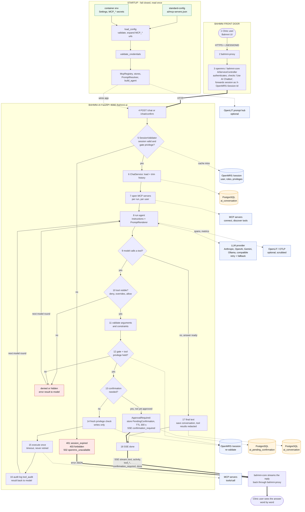

# bahmni-ai architecture documentation

Architecture of **bahmni-ai** (this repository) and how **standard-config** (`/Users/lingeswaransubramaniyam/Data/bahmni/standard-config`, read-only) drives it.

**Source-of-truth rule.** The code was read first (`src/bahmni_ai`, `pyproject.toml`, `Dockerfile`, `.github/workflows`, `tests`). The README and `docs/*.md` were then cross-checked against it. Where they disagree, the code wins and the mismatch is listed in [docs-vs-code-discrepancies.md](docs-vs-code-discrepancies.md). Anything not verifiable from the code is marked **Unverified**.

**Snapshot.** Branch `main`, last commit `69702c0`. The working tree has many uncommitted changes (new `providers/`, `prompts/`, `urlsafety.py`, moved `db/store.py`). This documentation describes the **working tree**, not the last commit. `uv run pytest` on this tree: 206 passed, 7 skipped.

## In one paragraph

bahmni-ai is a Python (FastAPI) service that gives Bahmni users a chat assistant. The browser never calls it directly: `bahmni-core` (inside OpenMRS) authenticates the user and proxies chat requests to it, passing the OpenMRS session id in the `X-OpenMRS-Session-Id` header. bahmni-ai re-validates that session against OpenMRS, runs an LLM agent (Pydantic AI) that can call tools on external **MCP servers**, and streams the answer back as Server-Sent Events. Which MCP servers exist, and which of their tools may be used by whom, is declared in `ai/mcp-servers.json` in **standard-config**, not in code. Every tool call is checked against OpenMRS privileges, writes need the user's confirmation, and every decision is audit-logged.

## End-to-end flow (one diagram)

Startup/config, front door, authentication, agent loop, tool policy, confirmation, storage and streaming back. Also available as [SVG](diagrams/00-end-to-end.svg) / [PNG](diagrams/00-end-to-end.png).

## Index

| Document | Contents |
|---|---|
| [01-overview.md](01-overview.md) | Inventory, system context (C4 L1), containers (C4 L2), runtime, cross-cutting concerns, observations |
| [02-modules.md](02-modules.md) | Each package with a component diagram (C4 L3), the module dependency graph, tests |
| [03-data-model.md](03-data-model.md) | Postgres tables, ER diagram, in-memory stores, lifecycles (state diagrams) |
| [04-api-and-flows.md](04-api-and-flows.md) | REST/SSE endpoints, events, error codes, sequence diagrams, flowcharts |
| [05-config-mapping.md](05-config-mapping.md) | standard-config areas mapped to the code that consumes them, and how they load |
| [06-deployment-and-cicd.md](06-deployment-and-cicd.md) | Docker, compose, OpenLIT stack, CI/CD pipeline |
| [docs-vs-code-discrepancies.md](docs-vs-code-discrepancies.md) | Where existing docs and code disagree |
| [diagrams/](diagrams/) | Every Mermaid diagram as a standalone `.mmd` file |

## Diagram index

| # | File | Kind | Shown in |
|---|---|---|---|
| 0 | `00-end-to-end.mmd` (+ `.svg`, `.png`) | **single end-to-end flow** | README (below) |
| 1 | `01-system-context.mmd` | C4 L1 | 01-overview |
| 2 | `02-container.mmd` | C4 L2 | 01-overview |
| 3 | `03a`..`03e-components-*.mmd` | C4 L3 (5 diagrams) | 02-modules |
| 4 | `04-module-dependencies.mmd` | package graph | 02-modules |
| 5 | `05-deployment.mmd` | deployment | 06-deployment-and-cicd |
| 6 | `06-er-model.mmd` | ER | 03-data-model |
| 7 | `07a`..`07g-seq-*.mmd` | sequences (7) | 04-api-and-flows |
| 8 | `08a`..`08d-flow-*.mmd` | flowcharts (4) | 04-api-and-flows, 03-data-model |
| 9 | `09a`..`09c-state-*.mmd` | state (3) | 03-data-model |
| 10 | `10-config-to-code.mmd` | config mapping | 05-config-mapping |
| 11 | `11-cicd-pipeline.mmd` | CI/CD | 06-deployment-and-cicd |

All 27 diagrams were rendered with `@mermaid-js/mermaid-cli` (Chrome headless) to validate syntax.

## Scope notes

- **bahmni-core, bahmni-docker, openmrs-distro-bahmni** are outside the two requested repos. They appear only where the contract with bahmni-ai matters. I confirmed `AiServiceController` and `AiServiceClient` exist in `bahmni-core` (uncommitted there too) and the `bahmni-ai` / `bahmni-ai-db` services exist in `bahmni-docker/bahmni-standard/docker-compose.yml`. Their internals are **Unverified** beyond what is quoted.
- **MCP servers** (documents, fhir) are external; their code is not in either repo. Their tool names are known only from `standard-config/ai/mcp-servers.json`.
- The standard-config areas other than `ai/` (apps, forms, reports, locale, ...) are consumed by OpenMRS/Bahmni apps, **not** by bahmni-ai. See [05-config-mapping.md](05-config-mapping.md).
